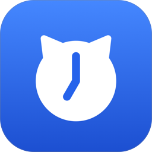
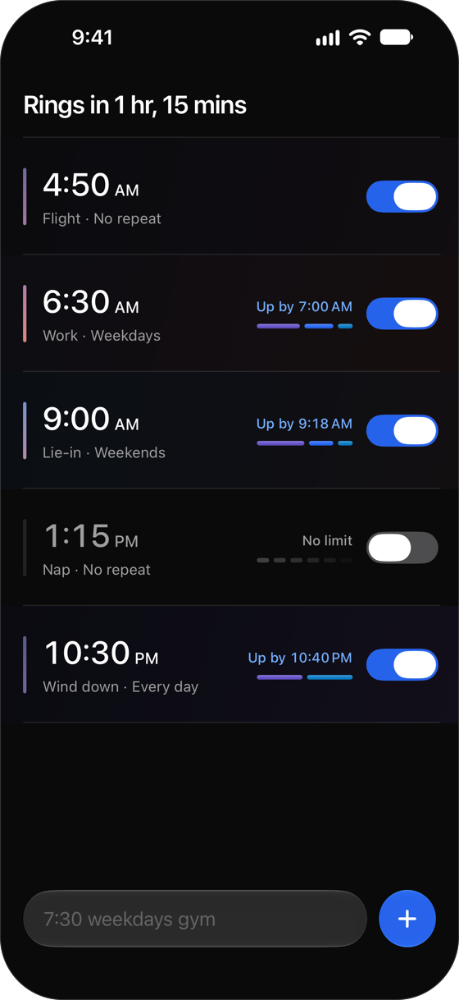
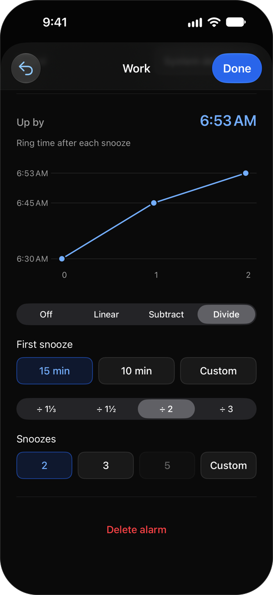
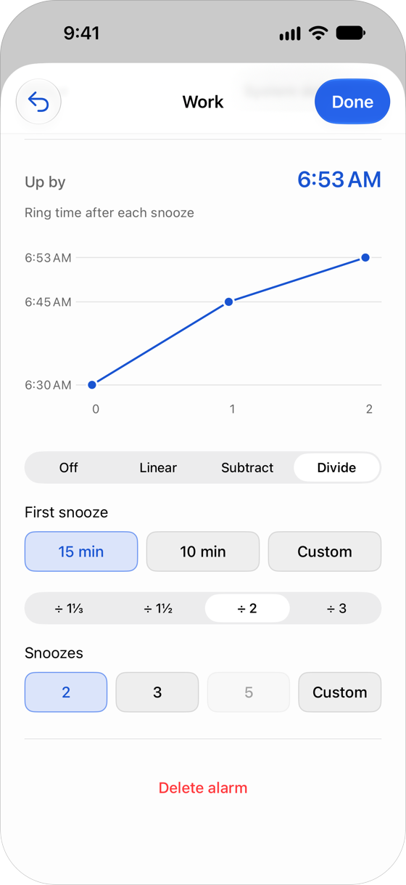
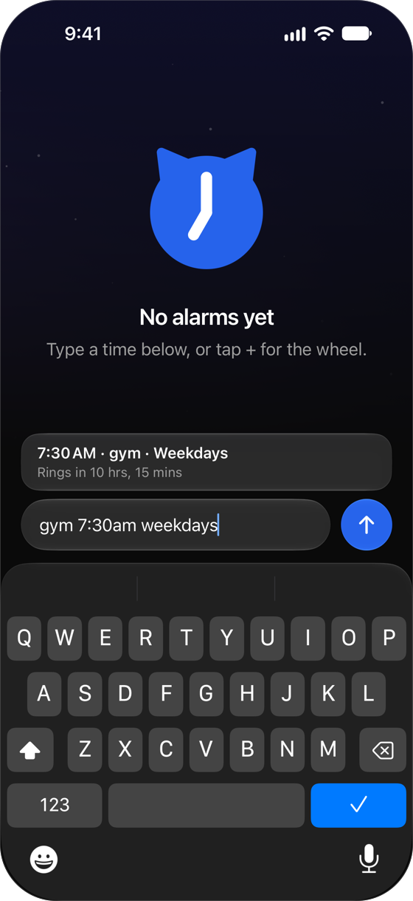
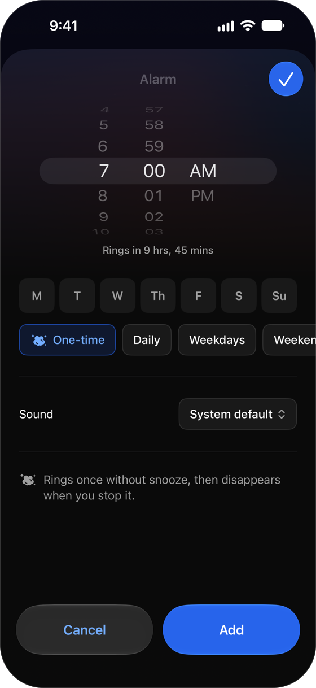
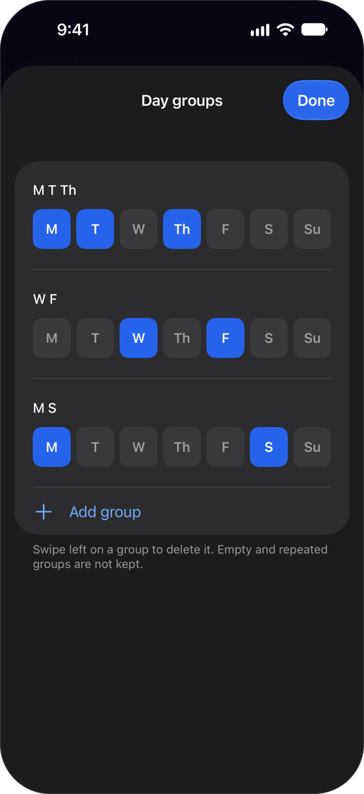
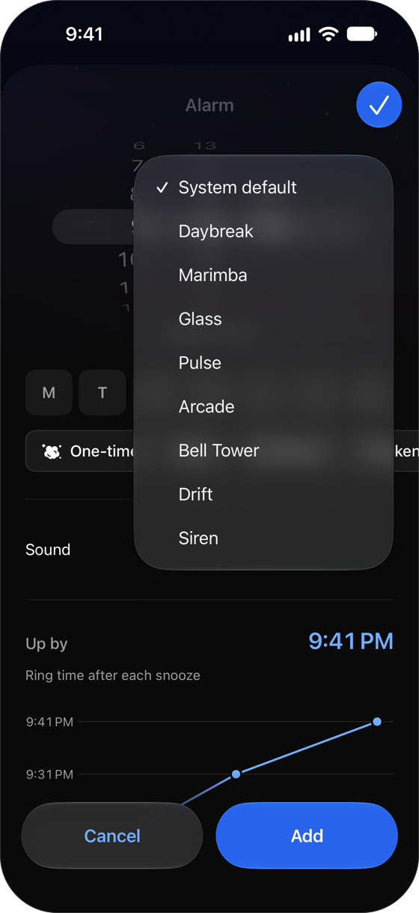

<p align="center">
  
</p>

<h1 align="center">Alarming</h1>

<p align="center">
  <strong>An iPhone alarm clock whose snoozes get shorter.</strong><br>
  Choose when it first rings and how each snooze shrinks, and see when you will actually be up.
</p>

<p align="center">
  <a href="https://github.com/cwlsn/alarming/actions/workflows/test.yml"></a><br>
  <sub>iOS 26.1 or later · Swift 6 · <a href="LICENSE">MIT license</a></sub>
</p>

<p align="center">
  
  
  
</p>

Most alarms snooze for the same length every time, so "five more minutes" quietly becomes an hour. Alarming makes each snooze shorter than the one before, and before you go to sleep it shows the time you will really be out of bed.

## What it does

- **Rings through Silent mode and Focus**, using Apple's AlarmKit.
- **Snooze styles**: Linear (every snooze the same), Subtract (minutes shorter each time), Divide (a fraction of the one before) or Off. Uneven divisions round up to the next minute, and snoozes shorter than a minute end the chain.
- **Wake-up graph**: the time of each ring, climbing to when you will be up. Drag across it to read a ring.
- **Quick add**: type `7:30 weekdays gym` or `in 20m nap`. Typed alarms without days are one-time.
- **One-time alarms**: ring once without snooze and delete themselves when stopped. **No repeat** alarms stay in the list, turned off.
- **Day groups**: your own sets of days, beside Daily, Weekdays and Weekends.
- **Widgets**: the next alarm on the Home Screen and Lock Screen, a Live Activity while snoozing, and a Control Center button that opens the app.
- **Private**: no account, no network code, no analytics. Alarms stay on the phone.

New alarms start at 15 minutes, minus 5 each time, for 2 snoozes, and then repeat your last choice.

<table>
  <tr>
    <td align="center" valign="top" width="25%"><br><b>Quick add</b><br><sub>Just type <code>7:30 gym</code></sub></td>
    <td align="center" valign="top" width="25%"><br><b>One-time</b><br><sub>Rings once, then goes</sub></td>
    <td align="center" valign="top" width="25%"><br><b>Day groups</b><br><sub>Your own sets of days</sub></td>
    <td align="center" valign="top" width="25%"><br><b>Sounds</b><br><sub>Eight wake-up tones</sub></td>
  </tr>
</table>

## Build

You need Xcode 27, [XcodeGen](https://github.com/yonaskolb/XcodeGen) and an iPhone on iOS 26.1 or later.

```sh
brew install xcodegen
xcodegen generate
open Alarming.xcodeproj
```

The Xcode project is generated and not committed, so run `xcodegen generate` after changing `project.yml` or adding a file.

To run on a phone, create `Config/Local.xcconfig` (git ignores it) with your team and a prefix of your own:

```
DEVELOPMENT_TEAM = XXXXXXXXXX
BUNDLE_PREFIX = com.example
```

A free developer account works, with Apple's limit of three such apps on one phone at a time.

## Test

```sh
cd Core && swift test
xcodebuild test -project Alarming.xcodeproj -scheme Alarming -destination 'platform=iOS Simulator,name=iPhone 18 Pro'
```

`Core` tests cover the rules: snooze lengths, scheduling, clock changes, storage, typed entries and what the widget shows. The UI tests drive the app against a stand-in for AlarmKit (the iOS 27 simulator refuses alarm permission), so they never set a real alarm.

Check these by hand on a phone before a release:

- With the phone locked, an alarm rings, Snooze works, and the last ring is visible, audible and ends with **I'm up** or **Stop**.
- The Live Activity counts down while snoozing, and **End** cancels the snooze.
- The Home Screen and Lock Screen widgets follow a change, and the Control Center button opens the app.

After a change to how the app looks, run `Scripts/screenshots.sh` to refresh the logo and screenshots in this README. It runs the UI tests on a fresh simulator with a clean status bar and keeps the screens they capture.

## How it is laid out

| Folder | Contents |
|---|---|
| `Core` | Swift package with every rule and no UI. Knows AlarmKit only through the `AlarmClient` protocol. |
| `App` | SwiftUI screens |
| `Shared` | Built into the app and the widget extension: AlarmKit client, alarm buttons, shared colors and symbol |
| `Widget` | Live Activity, widgets and Control Center button |
| `UITests` | UI tests, run with `-uiTesting` |
| `Scripts` | Generate the icon, the symbol, the tones and the README images. Each file's first lines show how to run it. |
| `docs` | README images, and [what AlarmKit does on a real phone](docs/alarmkit-findings.md) |

### Decisions worth knowing

- **A snooze is a new alarm.** Tapping Snooze schedules the next ring as a countdown and only then stops the current one, so a failure leaves the alarm ringing.
- **Each ring carries a copy of its alarm.** A snooze never needs the saved file, which may be locked before the first unlock after a restart.
- **The last ring after a snooze has two buttons.** With only Stop, iOS 27.2 shows nothing at all. Apps cannot hide, rename or restyle Stop.
- **An unreadable file is never treated as empty,** so alarms are not cancelled by mistake.
- **The widget reads a copy** of the alarms that will ring, from an app group. A one-time alarm leaves it once it rings. While you snooze, it shows the next regular alarm.

## Known limits

- Accessibility > Touch > Prefer Single-Touch Actions replaces iOS's slide-to-stop. Apps cannot set it.
- The interface is in English only.

## License

[MIT](LICENSE)
